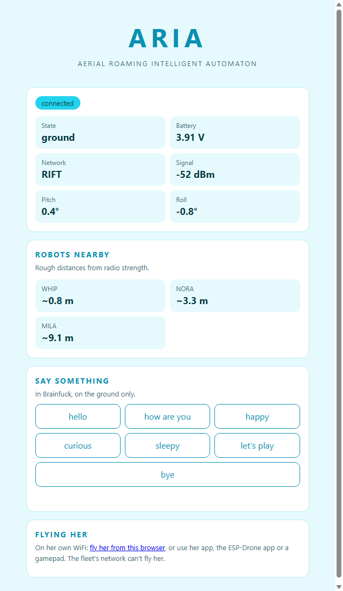
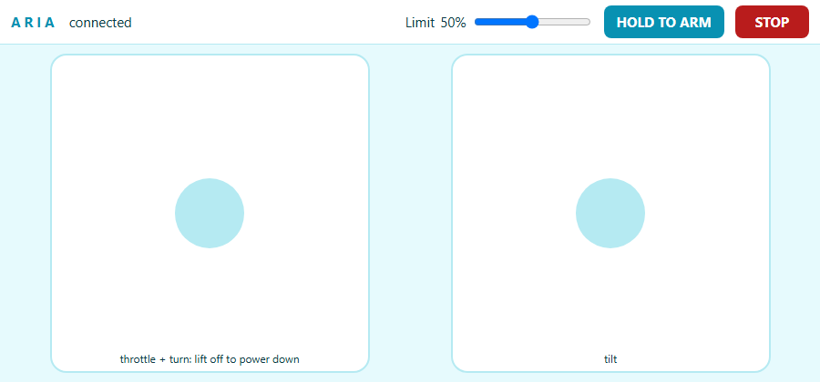
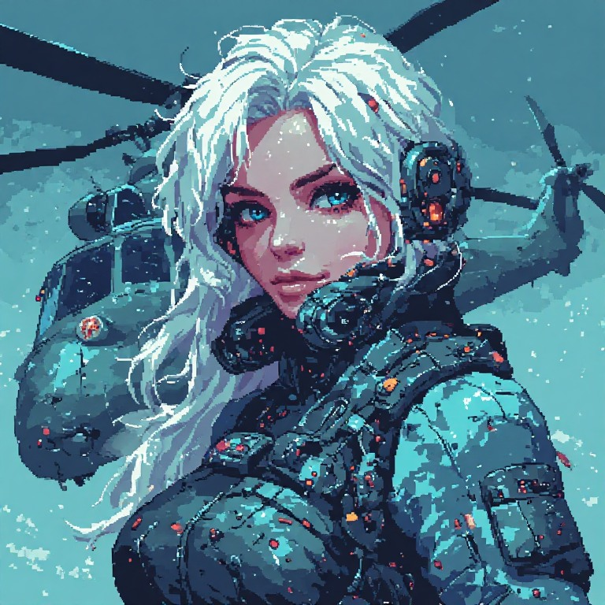

 

  

  

# ARIA
## Aerial Roaming Intelligent Automaton

- Robot Type: Drone
- Hardware: Diymore ESP32 Drone DIY Kit E1, on order: the CHERGLOW (琛光) E1 Mini, MPU6500 gyro over SPI. Sold as an ESP32-S3 with 716 motors, but her manual and the open design say a plain 30-pin ESP32 with 8520 motors, so the chip gets confirmed when she arrives. 3.7 V single-cell LiPo, not included.
- Based on: [CF-Drone](https://github.com/songge8/CF-Drone) e7f507f (CHERGLOW / songge8, built on [Flix](https://github.com/okalachev/flix) and ESP-Drone), her kit's own flight firmware. Her S3 pins come from [RayCyder/CF-Drone](https://github.com/RayCyder/CF-Drone), her hardware design is at [oshwhub](https://oshwhub.com/songge8/project_qqqyfdkm).
- Firmware: `scripts/aria_flight` (Arduino, English throughout), for a plain ESP32 or an S3. `scripts/esp-drone` is the earlier attempt, kept for reference and no longer used.
- Licence: GPL-3.0 with CF-Drone's additional terms (`scripts/aria_flight/LICENSE`). Personal and non-commercial use is exempt from those terms; selling her firmware or hardware isn't allowed without CHERGLOW's permission.
- Colours: cyan and white, like clouds
- Status: her firmware compiles for both chips and her link rules pass their tests on a PC. It has never run on her: she hasn't arrived, and nothing here is flight-tested.

### Her pages

  
  

### In the fleet

On top of CF-Drone (`scripts/aria_flight/aria_fleet.cpp`, `aria_ble.cpp`, `link_aria.ino`):

- **RIFT:** she keeps her own AP for the app and joins the highest fleet network she can see, then registers with whoever hosts the list. She only ever joins, she never hosts.
- **`:5014`:** her controller page (`web/`, RIFT's Open button), `GET /status` (flying, battery, network, signal), `GET /ping`, `GET /chirp?u=<0-16>`.
- **ESP-NOW:** the fleet's "I'm here" beacon twice a second, saying "park" or "go", and she hears everyone else's: `/near`.
- **Little windows:** her app and page show battery, pitch, roll, signal and network, and each nearby robot with a rough distance. It's from radio strength, so walls and antennas change it: hence the ~.
- **Brainfuck:** the fleet's phrases as flashes of her LED, on the ground only. The kit has no buzzer, and the S3 board has no spare LED, so there she stays quiet.
- **Flying from a browser:** on her own WiFi, `http://192.168.43.42:5014/fly` has two sticks over a WebSocket (`/fly-ws`). Her firmware refuses anyone on the fleet's network, caps tilt, yaw and thrust again, and her thrust lock and failsafes still hold.
- **Flying from her Android app:** `Android App/`, the same sticks and rules. Choose WIFI or BLUETOOTH in the app. Build it with `gradlew assembleDebug`; the APKs are kept in `Android App/apk/`.
- **Bluetooth:** press PAIR in her first two minutes after power-up and she pairs like a remote, then that phone reconnects any time. Flying needs the encrypted link, so strangers can't. It shares the radio with her WiFi.
- **A gamepad or flight stick:** over Bluetooth, or plugged in with a USB-C adapter (the phone must support USB OTG). Gamepad: pair it with the phone. Right trigger is the throttle (let go and she powers down), left stick turns, right stick tilts, hold A to arm, B stops. If it disconnects, she disarms. Flight stick: the stick tilts, its twist turns, the lever is the throttle; hold the trigger to arm, button 2 stops. A lever stays where it's left, so bring it down before you let go.
- **The official apps:** [ESP-Drone Android](https://github.com/EspressifApps/ESP-Drone-Android) and [ESP-Drone iOS](https://github.com/EspressifApps/ESP-Drone-iOS) fly her over WiFi too. Their flight packets are the ones her own app sends. Their Bluetooth code is Crazyflie's and doesn't reach her.
- **Safety:** the fleet can look at her and hear her, nothing in it can arm or fly her. It runs at the lowest priority, and with her motors spinning she won't scan, join a network or chirp, because a scan would cut the app flying her.
- **Her WiFi channel is 1**, the fleet's (CF-Drone's own WiFi uses channel 1 too).

### Flying rules

The same whichever way she's flown (app, browser, Bluetooth, ESP-Drone's own apps):

- She won't arm until she has seen thrust 0, and only from a low thrust. Holding 0 for 0.3 s disarms her.
- If the commands stop, she levels at 0.5 s and starts CF-Drone's controlled descent at 1 s.
- Tilt, yaw and thrust are capped in the firmware, whatever the app sends.
- CF-Drone's own protection stays on: no arming on a low battery or a failed gyro, landing on a critical battery, cutting out when upside down.
- Her stock remote page and debug console are still there, at `http://192.168.43.42` on her own WiFi `ARIA` / `12345678`.

### When she arrives

With the **propellers off**:

1. `scripts\flash.ps1 -Backup` saves her factory firmware.
2. `scripts\flash.ps1 -Sketch aria_pin_finder`, then WiFi `ARIA_PINS` / `12345678` and `http://192.168.4.1`. It shows her chip, finds the gyro and battery, and pulses one pin at a time at 15% so you can see which motor is which.
3. If the pins differ from `board_config.h`, change them there, or use `p MOT_PIN_FL <pin>` on the console.
4. `scripts\flash.ps1` flashes her flight firmware, for whichever chip she has.
5. On the debug console at `http://192.168.43.42`: `ca` for the six-side calibration, `ps` to check it (roll and pitch near 0), then `mfl`, `mfr`, `mrl`, `mrr` for each motor.
6. Pair her app, arm with no propellers, and check each stick moves the right motors the right way before the first flight.

Her logic tests: `g++ -std=c++17 -mno-ms-bitfields -Iscripts/aria_flight -Iscripts/aria_pin_finder scripts/aria_flight_test/test.cpp -o test`. Change a page in `web/`, then run `python scripts/embed_web.py aria_flight`.

`python scripts/fake_aria.py` is a pretend ARIA on this PC, for trying the page and RIFT's link with no drone.

Not done: the ladder's climbing while she's on a lower network (she looks again only when she has no network), and following a host's change mid-flight.
- Site: https://cursedprograms.github.io/ARIA-Robot-v00/

  

ARIA is the flying member of the DREAM Robotics fleet. The plan is the same as the rest of the fleet: she joins RIFT's network, answers `/status`, and talks to the others. CF-Drone gives her stabilised flight, a web remote and a debug console, and QGroundControl, ELRS or SBUS can fly her too. Her spare headers take a barometer, laser rangefinder, compass and optical flow sensor.

Credit: [Farica☆Kimora](https://github.com/Farica-Kimora) © Cursed Entertainment

---

 

&copy; Cursed Entertainment 2026

 

**Windows controller:** [`builds/ARIA-Controller.exe`](builds/ARIA-Controller.exe) shows ARIA's own web page in a window, so it always matches the page. Source: `scripts/web_controller`.

## Related Projects

- [KIDA-Robot-v01](https://github.com/CursedPrograms/KIDA-Robot-v01)
- [KIDA-Robot-v00](https://github.com/CursedPrograms/KIDA-Robot-v00)
- [WHIP-Robot-v00](https://github.com/CursedPrograms/WHIP-Robot-v00)
- [NORA-Robot-v00](https://github.com/CursedPrograms/NORA-Robot-v00)
- [MILA-Robot-v00](https://github.com/CursedPrograms/MILA-Robot-v00)
- [NIKA-Robot-v00](https://github.com/CursedPrograms/NIKA-Robot-v00)
- [IDA-Robot-v00](https://github.com/CursedPrograms/IDA-Robot-v00)
- [ARM-Robot-v01](https://github.com/CursedPrograms/ARM-Robot-v01)
- [DREAM](https://github.com/CursedPrograms/DREAM)
- [RIFT](https://github.com/CursedPrograms/RIFT)
- [RITA](https://github.com/CursedPrograms/RITA)
- [NINA](https://github.com/CursedPrograms/NINA)
- [TINA](https://github.com/CursedPrograms/TINA)

---

<!-- DREAM-ECOSYSTEM:START -->
## The DREAM Robotics ecosystem

**Minds** — [DREAM](https://github.com/CursedPrograms/DREAM) companion · [TINA](https://github.com/CursedPrograms/TINA) engineer · [NINA](https://github.com/CursedPrograms/NINA) caretaker · [RIFT](https://github.com/CursedPrograms/RIFT) fleet hub · [LYCEA](https://github.com/CursedPrograms/LYCEA) training school  
**Robots** — [NORA](https://github.com/CursedPrograms/NORA-Robot-v00) · [MILA](https://github.com/CursedPrograms/MILA-Robot-v00) · [WHIP](https://github.com/CursedPrograms/WHIP-Robot-v00) · [KIDA-00](https://github.com/CursedPrograms/KIDA-Robot-v00) · [KIDA-01](https://github.com/CursedPrograms/KIDA-Robot-v01) · [IDA](https://github.com/CursedPrograms/IDA-Robot-v00) · [ARM](https://github.com/CursedPrograms/ARM-Robot-v01) · [NIKA](https://github.com/CursedPrograms/NIKA-Robot-v00) · [ARIA](https://github.com/CursedPrograms/ARIA-Robot-v00)  
**Remotes** — [RITA](https://github.com/CursedPrograms/RITA) handheld remote  
<!-- DREAM-ECOSYSTEM:END -->
